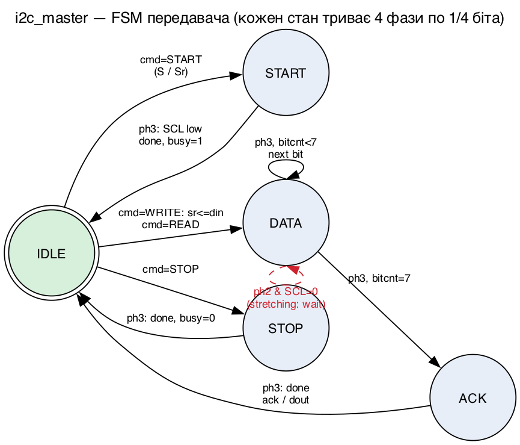
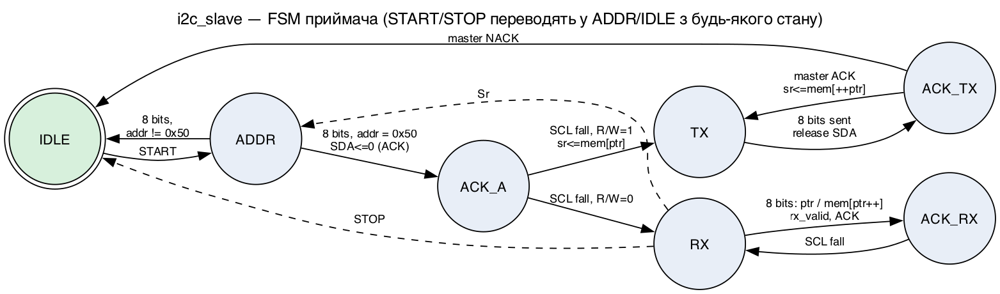
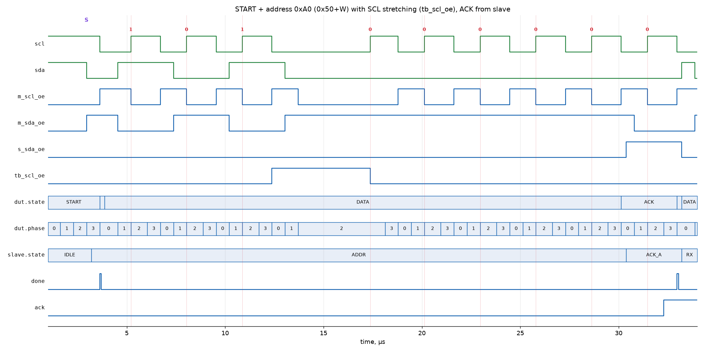
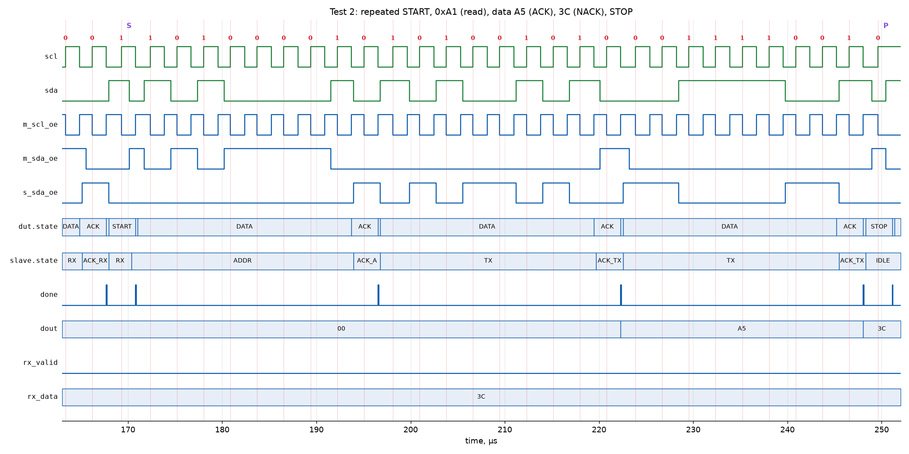

# Лабораторна робота №3 — послідовний протокол I2C на ПЛІС

**Дисципліна:** Автоматизоване проєктування комп'ютерних систем
**Студент:** Сидорук Артем Васильович, група КІ-404
**Варіант:** 20 — протокол **I2C**, мова **Verilog**

## Склад

| Файл | Призначення |
|------|-------------|
| `rtl/i2c_master.v` | I2C master (передавач): генерація SCL з дільника, START / repeated START / STOP, передача та прийом байтів, ACK/NACK, підтримка clock stretching |
| `rtl/i2c_slave.v` | I2C slave (приймач) з адресою `0x50` і регістровим файлом 16×8: запис з автоінкрементом вказівника, читання |
| `tb/tb_i2c.v` | самоперевірний тестбенч: open-drain шина з pull-up, незалежний монітор шини, 4 тести |
| `tools/plot_vcd.py` | побудова часових діаграм з VCD (PNG) |
| `docs/fsm/*.dot` | діаграми станів master і slave (Graphviz) |
| `syn/` | top-модулі для синтезу під iCE40 UP5K |

## Запуск

Потрібні Icarus Verilog, Yosys, nextpnr-ice40, Python 3 з matplotlib (лише для діаграм).

```bash
make sim     # симуляція, очікується "TESTS PASSED"
make waves   # часові діаграми в docs/img
make syn     # синтез і P&R для iCE40 UP5K (sg48), звіт Fmax
```

## Параметри

| Параметр | Значення |
|----------|----------|
| Системна частота | 12 МГц |
| Частота SCL | 375 кГц (Fast-mode ≤ 400 кГц; дільник 1/4 біта = 8, округлено вгору) |
| Адреса slave | `0x50` (7 біт) |
| Цільова ПЛІС | Lattice iCE40 UP5K, корпус SG48 |

## Тести

1. Запис `A5`, `3C` у регістри 2–3; під час адресного байта тестбенч утримує SCL низьким 5 мкс (clock stretching).
2. Читання регістрів 2–3 з repeated START: `A5` (ACK майстра), `3C` (NACK, останній байт).
3. Звернення до неіснуючої адреси `0x42` → NACK.
4. Пакетний запис і читання 4 байтів `00 FF 55 AA`.

Монітор шини декодує START/STOP і кожен 9-бітний кадр прямо з SCL/SDA та порівнює з очікуваним потоком.

## Діаграми станів





## Часові діаграми





## Синтез і часовий аналіз (iCE40 UP5K, Yosys + nextpnr)

| Модуль | Logic cells (LC) | з них FF | SB_LUT4 | SB_IO | Fmax | Вимога |
|--------|------------------|----------|---------|-------|------|--------|
| `i2c_top` (master) | 81 / 5280 (1 %) | 40 | 62 | 29 | **76.03 MHz** | 12 MHz → PASS |
| `slave_top` (slave) | 448 / 5280 (8 %) | 170 | 297 | 17 | **41.57 MHz** | 12 MHz → PASS |

Регістровий файл slave (16×8) реалізовано на тригерах, бо він скидається асинхронно; без скидання Yosys міг би покласти його в блокову пам'ять.

Для I2C Fast-mode (400 кГц) master потребує системної частоти ≥ 1.6 МГц (дільник 1/4 біта ≥ 1), а slave — ≥ ~8 МГц, щоб надійно семплювати SCL/SDA після синхронізаторів. Fmax обох модулів у 3.5–6 разів більший за робочі 12 МГц.
